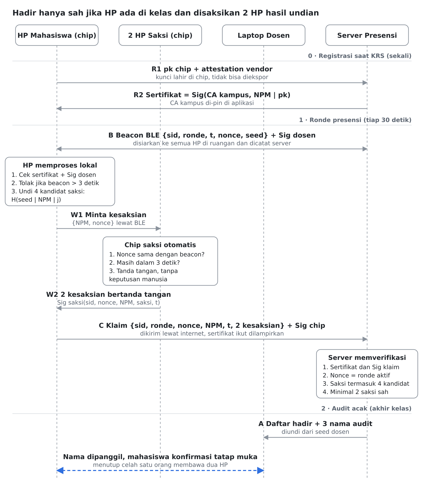

# Attendance Proof

Simulasi protokol presensi anti titip absen. Dibuat untuk Checkpoint 3 mata kuliah Kriptografi, Informatika UAJY: *Rancang Protokolmu Sendiri*.

Kehadiran hanya sah jika dua hal terbukti sekaligus. Pertama, klaim ditandatangani oleh kunci yang terkunci di secure chip HP mahasiswa sehingga tidak bisa disalin ke HP lain. Kedua, HP itu benar ada di kelas karena disaksikan oleh 2 HP lain yang dipilih lewat undian, bukan dipilih sendiri.



## Cara menjalankan

```bash
pip install -r requirements.txt
python simulate.py     # skenario normal + serangan, dengan penjelasan
pytest -q              # versi otomatis dari skenario yang sama
```

Contoh output:

```
OK [LOLOS     ] S0 Kelas normal, 20 mahasiswa
               20/20 mahasiswa hadir terverifikasi, masing masing dengan 2 saksi hasil undian
OK [TERDETEKSI] A1 Absen dari rumah, foto beacon dikirim lewat WA
               ProtocolError: beacon basi (8.0 s > 3.0 s)
OK [TERDETEKSI] A5 Saksi dipilih sendiri, bukan hasil undian
               ProtocolError: saksi Andi bukan hasil undian untuk Budi (kandidat: Lala, Made, Raka, Joko)
...
12/12 skenario sesuai ekspektasi desain
```

## Ide protokol

| Fitur | Menutup modus |
| --- | --- |
| Kunci di secure chip, non exportable, disertai attestation vendor | Menitipkan kunci atau akun ke joki |
| Sertifikat CA kampus yang mengikat NPM ke public key chip | Joki memakai identitas orang lain di HP sendiri |
| Beacon dosen bertanda tangan, nonce baru tiap ronde, jendela 3 detik | Foto QR atau beacon dikirim lewat WA, replay |
| Saksi tetangga: 2 dari 4 kandidat hasil undian `H(seed, NPM, j)` | Absen dari rumah, memilih teman sendiri sebagai saksi |
| Audit acak 3 nama per pertemuan | Satu orang membawa dua HP |

Kunci yang dipakai:

- **CA kampus (Ed25519):** public key di-pin di aplikasi, dan menandatangani sertifikat dosen dan mahasiswa saat registrasi tatap muka.
- **Kunci chip mahasiswa dan dosen (Ed25519):** dibuat di dalam chip dan tidak pernah keluar.
- **Root attestation vendor:** membuktikan ke kampus bahwa sebuah public key memang lahir di chip asli.

Server presensi tidak memegang private key siapa pun. Server hanya memverifikasi bukti, sehingga admin server juga tidak bisa menyisipkan kehadiran palsu.

## Hasil simulasi

| Kode | Skenario | Hasil |
| --- | --- | --- |
| S0 | Kelas normal, 20 mahasiswa | Semua hadir terverifikasi |
| A1 | Foto beacon dikirim lewat WA (delay 8 detik) | Ditolak: beacon basi |
| A2 | Beacon sampai tepat waktu, tapi HP di rumah | Ditolak: saksi kurang (0/2) |
| A3 | Mengekspor private key dari chip | Ditolak: kunci non exportable |
| A4 | Joki memasang sertifikat Budi di HP sendiri | Ditolak: tanda tangan klaim tidak valid |
| A5 | Saksi dipilih sendiri | Ditolak: saksi bukan hasil undian |
| A6 | MITM: beacon dengan kunci dosen palsu | Ditolak: sertifikat dosen tidak valid |
| A7 | Replay klaim ronde sebelumnya | Ditolak: nonce berbeda |
| A8 | MITM: NPM pada klaim diubah di jalan | Ditolak: tanda tangan klaim tidak valid |
| A9 | Admin server menyisipkan kehadiran | Ditolak: tanda tangan klaim tidak valid |
| B1 | Relay BLE cepat lewat proxy di kelas | **Lolos**, batasan yang diakui |
| B2 | Satu orang membawa dua HP | **Lolos kriptografi**, ketahuan audit dengan peluang sekitar 15% per pertemuan, 90% dalam 14 pertemuan |

B1 dan B2 sengaja ditampilkan sebagai batasan desain. B1 membutuhkan distance bounding (mengukur waktu tempuh sinyal) yang tidak bisa diselesaikan dengan tanda tangan saja.

## Apa yang asli dan apa yang disimulasikan

Asli:
- Semua tanda tangan dan verifikasi Ed25519 (library `cryptography`).
- Rantai sertifikat, undian saksi berbasis SHA256, dan pengecekan nonce.

Disimulasikan:
- **Secure chip:** private key disimpan di closure tanpa API ekspor. Di HP sungguhan ini dijamin hardware, misalnya Android StrongBox atau iOS Secure Enclave.
- **Bluetooth:** dimodelkan sebagai jarak antar kursi dengan jangkauan 12 meter.
- **Waktu:** memakai jam simulasi dalam detik.

## Struktur

```
attendance_proof/
  crypto.py     encoding kanonik, Ed25519, hash
  chip.py       SecureChip dan root attestation vendor
  pki.py        CA kampus dan sertifikat
  protocol.py   beacon, saksi, klaim, verifier, undian, audit
  sim.py        ruang kelas virtual dan semua skenario serangan
simulate.py     menjalankan semua skenario
tests/          pytest
```

Catatan: desain ini dibuat untuk pembelajaran, bukan sistem presensi produksi yang sudah diaudit. Nama mahasiswa di simulasi adalah fiktif.
